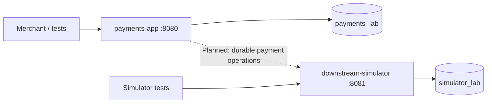

# Base Payments EventSourcing

A payments architecture playground built with **Java 25, Spring Boot 4.1.1 and DynamoDB Local**.

The question: how can an event-sourced payment system keep its decisions durable when requests race, responses disappear, and purchase documents exceed DynamoDB's item size?

**Today:** a tested session lifecycle and independent downstream simulators. **Next:** connect authorization, order creation and recovery into the payment application. This is a local experiment, not a production payment gateway.

## Understand it in two minutes

- A **session** belongs to one merchant and holds a replaceable purchase.
- A **purchase revision** is immutable; events reference its chunked payload.
- **Events** are the business history. A conditional transaction saves new events, session projections and the idempotent result together.
- Retrying a completed command returns its **original result**, even after the session changes.
- The standalone simulator records effects before simulating a lost response.



Both tables live in the same local DynamoDB instance. The dashed integration is **not implemented**.

## Run locally

Install JDK 25 and Docker with Compose. Open this directory as a Gradle project in IntelliJ; use the included wrapper.

```bash
docker compose up -d dynamodb
./gradlew :payments-app:bootRun
```

In another terminal:

```bash
curl -i -X POST http://localhost:8080/v1/sessions \
  -H 'X-Merchant-Id: merchant-demo' \
  -H 'Idempotency-Key: create-001' \
  -H 'Content-Type: application/json' \
  --data '{"amountMinor":10000,"currency":"BRL","merchantReference":"cart-100","attributes":{"customer":"Ana"}}'
```

Repeat that request: the same session and original response are returned. Read it at `GET /v1/sessions/{sessionId}`; replace the purchase with `PUT`, a new idempotency key and the current `If-Match` ETag.

Health: `http://localhost:8080/actuator/health`. Start the simulator separately with `./gradlew :downstream-simulator:bootRun`.

DynamoDB uses port 8000 and a persistent Compose volume. Ordinary `docker compose down` preserves that volume; do not remove it if you need the stored history.

## Verify a change

Python 3.9+ is needed only for the documentation checks; the application uses Java.

```bash
./gradlew check                 # unit tests, formatting, parameter rules
./gradlew integrationTest       # starts DynamoDB through the shared Compose file
./gradlew spotlessApply         # formats Java
python3 scripts/check-docs.py   # local documentation links, IDs and evidence
```

Integration tests use isolated tables and remove those tables afterward. There is no Testcontainers dependency. Tests express Given/When/Then behavior in JUnit; the Gherkin example is not a Cucumber test suite.

## Read only what you need

| Your question | Start here |
| --- | --- |
| What works, and where is the proof? | [Requirements and evidence](docs/requirements.md) |
| How does a request become durable state? | [Architecture and diagrams](docs/architecture.md) |
| What can I call today? | [HTTP walkthrough](docs/api.md) |
| Why was it designed this way? | [Decision records](docs/decisions/README.md) |
| How should tests evolve? | [Test assessment](docs/test-assessment.md) |
| How should I change it? | [Contributing](CONTRIBUTING.md) and [parameter guidelines](docs/parameter-guidelines.md) |
| How should an AI agent work here? | [Repository rules](AGENTS.md), [working memory](docs/agent-memory.md), [documentation skill](.agents/skills/maintain-project-docs/SKILL.md) |

## Important boundaries

Chunking removes the single-item ceiling for purchase payloads; it does not create infinite memory, network capacity or unlimited metadata. Uploads currently buffer data in memory and can leave unreferenced payloads after failed commits.

Authorization/order APIs in the payment application, recovery workers, durable webhooks, safe purge, a complete projection-rebuild tool and process-restart guarantees are still roadmap items. The simulator's order uniqueness is not evidence of an end-to-end application guarantee.

No real payment services, AWS infrastructure deployment or production authentication are included. DynamoDB Local results are not AWS throughput or latency claims.
