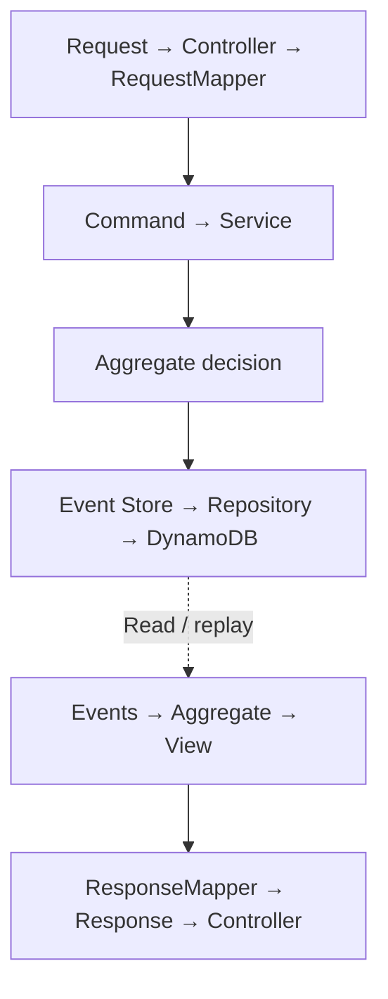
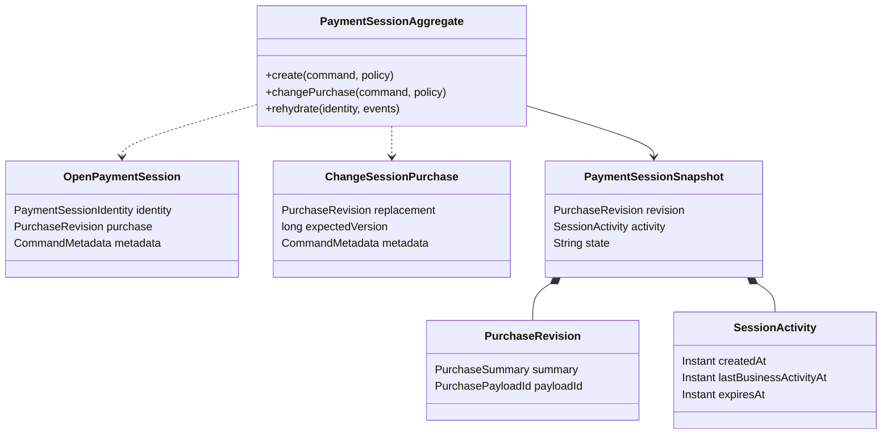
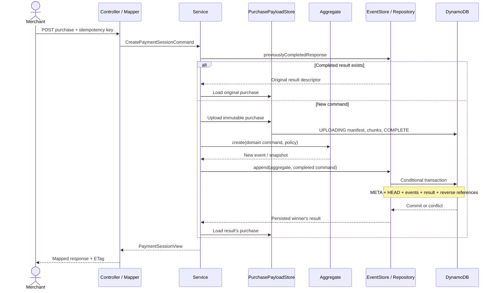

# Architecture: a decision, its history and its durable result

Read this after the [two-minute introduction](../README.md). The current vertical slice is **payment sessions**, not the complete authorization/order workflow.

## Boundaries and request spine

This is a responsibility map, not a claim that the aggregate calls a repository. The application service invokes the aggregate, then passes its uncommitted events to the event-store port. Reads query events, rehydrate the aggregate and load the referenced purchase payload before producing a view.

| Boundary | Owns | Does not own |
| --- | --- | --- |
| Entry | Headers, request validation, MapStruct mapping, HTTP response | Business transitions |
| Application | Use-case coordination, clock choice, idempotency lookup, ports | DynamoDB item construction |
| Domain | Session identity, revisions, version/expiry checks, events | Spring, AWS, HTTP requests |
| Infrastructure | Payload chunks, JSON documents, conditional transactions | Business rules |
| Simulator | Persistent external effects, result lookup, controlled failures | Payment-app recovery orchestration |

`common/src/main/java` is shared technical source compiled into both Gradle modules, not a third module or shared aggregate. Domain failures currently inherit common exception types that carry HTTP status; this coupling remains a design limitation.

## Important domain types

The aggregate already knows its identity. A change command supplies a replacement revision, expected version and command metadata—not transport headers or database settings. The expiration policy is pure; replay applies stored values rather than reading the clock again.

Current facts are PaymentSessionCreated and PurchaseChanged. Only OPEN is currently produced. Expiry is enforced by the command guard; an EXPIRED event/state worker is not implemented.

## Creation and retries

The payload upload is **not** inside the session transaction. Interrupted uploads or losing concurrent creates can leave unreferenced payloads. Cleanup is not implemented. A successful session transaction references a completed immutable payload.

On a same-key race, a losing writer reconciles the durable winner's response. On an unresolved persistence outcome, the API returns 503; clients retry the same key. A completed creation retry returns the original purchase, while GET returns the current purchase.

## DynamoDB layout

Two independent tables: payments_lab and simulator_lab. Test names have unique suffixes.

| Address | Sort key | Purpose |
| --- | --- | --- |
| `M#merchant#S#session` | `META` | Stream version and lifecycle |
| Same session partition | `HEAD` | Synchronously maintained projection |
| Same session partition | `EVT#<20-digit sequence>` | Individual immutable events |
| Same session partition | `REF#PAYLOAD#<digest>`, `REF#IDEMP#<digest>` | Reverse references |
| `M#merchant#PAYLOAD#payloadId` | `MANIFEST`, `CHUNK#<10-digit index>` | Immutable purchase |
| `M#merchant#IDEMP#digest` | `RESULT` | Completed command response descriptor |

JSON is stored under data; keys and selected condition/index attributes also exist as native attributes. A sparse work index is provisioned, but workers are not implemented. TTL-based deletion is not enabled.

GET currently queries the event stream with consistent reads and rehydrates it; it does **not** read HEAD as its source. Separating HEAD from META preserves a future projection-rebuild path, but a complete rebuild tool does not yet exist.

Payloads use 200 KiB raw chunks, Base64-encoded with room for item metadata. A complete manifest publishes checksum and chunk count; reads validate them. The whole request and reconstructed document are buffered in memory. Chunking is not streaming and does not remove item/transaction limits or metadata constraints.

## Next boundary

Authorization must persist an intent, call the simulator with stable identities, then commit the known result. Recovery, ownership leases, one-order reservation, outbox, retention and resumable purge remain [planned requirements](requirements.md). These diagrams do not represent them as running components.

See [decision records](decisions/README.md) and [parameter guidelines](parameter-guidelines.md) for implementation choices.
